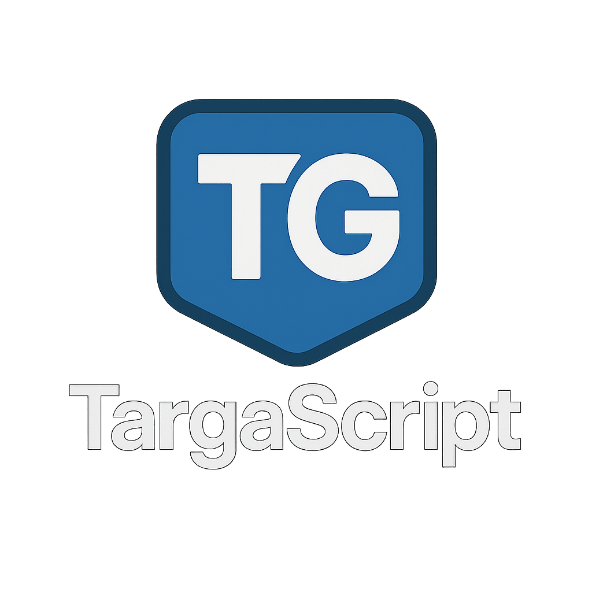

# TargaScript 🚀

> If TypeScript can be rewritten in Go, why not create our own language with Go?

TargaScript is a small, modern scripting language that runs in your terminal, in web pages and inside Go programs. It reads like JavaScript, has the conveniences of newer languages (pipes, pattern matching, destructuring, top-level `await`), and comes with everything around it: a web server, a test runner, a formatter, a REPL and editor support, in one binary. Files use the `.tg` extension.

**[▶ Try TargaScript in your browser](https://migueltarga.github.io/TargaScript/)**, no install needed. The playground itself is written in TargaScript and runs on WebAssembly.

📖 The [language reference](docs/REFERENCE.md) covers everything in one page, the [cookbook](docs/COOKBOOK.md) has short programs for everyday jobs (CSV files, JSON, web APIs, servers, tests), and [coming from JavaScript or Python](docs/COMING_FROM.md) shows how to write what you already know.

## 🌟 Why TargaScript

- **One language for scripts and web pages.** The same code runs from a 7 MB command-line binary and in the browser from a WebAssembly runtime of about 200 KB compressed: add `<script type="text/targascript">` to a page, with no build step.
- **Asynchronous code that reads top to bottom.** `await fetch(url)` and `await sleep(ms)` work in scripts and in the browser, with no callbacks.
- **Errors that help.** Mistakes point at the exact spot in your code with the calls that led there, a typo gets a "Did you mean...?", and habits from other languages get the TargaScript way: `list.push(x)` suggests `insert`, `for` suggests `repeat`, `a.b` on null suggests `?.`.
- **Small, modern syntax.** The pipe operator `|>`, arrow functions, `match` with guards, string interpolation, destructuring, spread, `??` and `?.`, default and rest parameters, `try`/`catch`, closures.
- **A better shell script.** `exec("git status --short")` runs other programs and gives their output and exit code, `#!/usr/bin/env targascript` makes a file a command, and files, directories and environment variables are a function call away, with real data structures instead of string juggling.
- **A web server built in.** `serve(8080, req => "Hello")` is a working HTTP server; return an object and it's sent as JSON.
- **Embed it in Go.** `targascript.New().Run(rule)` gives your Go program a safe scripting language for user rules, formulas and plugins; see [embedding](docs/EMBEDDING.md).
- **Ship one file.** `targascript build app.tg` makes an executable with the program and everything it loads; whoever gets it doesn't need TargaScript.
- **The tools are included.** `targascript fmt`, `check`, `test` and `build`, `--watch` to run again on every save, a REPL with history and Tab completion, a VS Code extension, and a language server for Neovim, Helix and other editors.
- **Tests built in.** `test("name", fn)`, `assert` and `assertEqual` need no library, and `targascript test` runs every `*_test.tg` file.
- **Built for working with data.** JSON, `map`/`filter`/`reduce`, `groupBy`, `sortBy`, `sum`, `unique` and more, on arrays and objects that keep their order.
- **As fast as Python.** Programs compile to bytecode for a VM that runs about as fast as CPython on [these benchmarks](bench/), and allows 10,000 nested calls, in the browser too.

## ⚖️ Compared with Python and JavaScript

| | TargaScript | Python | JavaScript (Node) |
|---|---|---|---|
| Runs in a web page with no build step | ✅ `<script type="text/targascript">`, ~200 KB | ⚠️ through Pyodide, several MB | ✅ |
| One file to install, no runtime | ✅ | ❌ | ❌ |
| Turn a script into an executable to share | ✅ `targascript build` | ⚠️ with PyInstaller | ⚠️ single executable apps, experimental |
| HTTP server in a few lines, no library | ✅ `serve(8080, fn(req) {...})` | ⚠️ `http.server`, low level | ⚠️ `http.createServer`, low level |
| Test runner, no library | ✅ `targascript test` | ✅ `unittest` | ✅ `node --test` |
| Run a command and get its output | ✅ `exec("git log -1").output` | ⚠️ `subprocess.run(..., capture_output=True, text=True)` | ⚠️ `execSync(...).toString()` |
| Rerun on save, built in | ✅ `--watch` | ❌ | ✅ `node --watch` |
| `await` at the top of a script | ✅ | ❌ needs `asyncio.run` | ✅ in modules |
| Pipe operator | ✅ `x \|> f` | ❌ | ❌ (a proposal) |
| Pattern matching | ✅ `match` | ✅ `match` | ❌ |
| Errors that know other languages | ✅ `push` → "use insert(value)" | ⚠️ "Did you mean" for typos | ❌ |
| Objects keep insertion order, JSON built in | ✅ | ✅ | ✅ |

TargaScript is young and small: no packages, no classes, no threads. It aims at scripts, small servers and web pages, where those are rarely missed.

## 📝 A Taste

```
// Count the latest commits of a repository by author
let url = "https://api.github.com/repos/migueltarga/TargaScript/commits?per_page=50"
let response = await fetch(url)
if !response.ok { throw "GitHub answered ${response.status}" }

let byAuthor = response.json().groupBy(({commit}) => commit.author.name)

repeat name, commits in byAuthor {
    print("${name.padEnd(20)} ${commits.length} commits")
}
```

[▶ Try it in the playground](https://migueltarga.github.io/TargaScript/#code=RJBPS8QwEMXv-RTPsocWJFkEL0IVFdG73iXtzrbRNgmTCUsp_e6y3T9eAmHe_N68ZwxeQ_YC6QmDFUqCNoyjk4SwhwVTDMlJ4AnNBJulD6wGEmQeUKPoRWJ6MMZGpzsnfW50G0azrpnRdZkGsdxZ83V8P1t2UczZ4SkSf0fbUX2_LVYoU4rBJ0INe7BOsCdp-zLzUCm3x81lrsMvZkjP4YDi3clHbmB9OhDTDpv5KktiJaelwKJWfjM9rwlQX630Twq-rHTHIceXqSzn03VLhfrx3IU-5dbejlQpxRTJCo6_22tbzv_TZwUAkZ2XstjMR6GOdvfmd-XdtlqwOXskPZDvpF8ulKJSi_oLAAD__w)

And the basics:

```
fn greet(name, greeting = "Hello") {
    "${greeting}, ${name}!"
}

let person = {"name": "Alice", "skills": ["programming", "design"]}
print(greet(person.name))                  // Hello, Alice!

repeat i, skill in person.skills {
    print("${i + 1}. ${skill}")
}

let [first, ...rest] = [1, 2, 3]
print(person.address?.city ?? "unknown")   // unknown

let words = "  Hello World  "
    |> (s => s.trim().lower())
    |> (s => s.split(" "))
print(words)                               // ["hello", "world"]
```

[▶ Try it in the playground](https://migueltarga.github.io/TargaScript/#code=bJGxbvMgFIV3nuLkyoPRj4jyd4vkWN36Bh0sD1ZMXBQMFlBZlet3rwzOkpYJdNA53z33ZjF4pWJpu1GJfNd2QAV6U8Y44lgYAFCxPMRVoFi2_-uB2MqYURGT8sFZVFhoU-gMejX6qkiAwl0bE-iMhibvBt-No7bDpvQq6MFSu7LJaxvLjJK95ObDOX6d4xEJTSAlHBjzalJdhBZIUdB255E5eh8hZ1CxaPzDaZUolqSvxB9jNDftQxSQUnoVYosKzUngv8BLuzPuzl3fexVCLa86fqGuQZ_2bt1siWfG_Zl9Z-f7sJWKzI53500PUAL7vqAMqC4IMno9llwaNytfcv4sh8noWBKI8x0nOf_R0nNlDX2kfQrQvGVTy34CAAD__w)

## 🔀 Matching Values

`match` picks the first arm whose values match, comparing with `==`. A range matches the numbers between its ends, and `_` matches anything:

```
fn describe(n) {
    match n {
        0 => "none"
        1, 2 => "a few"
        3..9 => "several"
        _ => "many"
    }
}

fn route(req) {
    match req.method {
        "GET" if req.path == "/" => "home"
        "GET", "HEAD" => "page ${req.path}"
        _ if req.headers["x-admin"] == "yes" => "admin"
        _ => "not allowed"
    }
}
```

[▶ Try it in the playground](https://migueltarga.github.io/TargaScript/#code=fJBBS8MwHMXv_RSP4KGDWOdkBwsTBIcePehpDInLv7bQJF0anaP0u0uTdu0E7a3vvby8XzINSfXOFu8U6xmaCACUcLscuv_rvjlWd2DaaGIn7Zpj4WWBjA6jfpMkt16v6YusKEfnzctK6GPQ2qiNokzDmk9HsaX9-QBL-0SRy42cLGGP6xeGIvNuJVyO1Qrsivnq3KjJQB_lYE_r-4fgV-KDcNEMR9vptL4yJyHJ1hv2fSmkKjTb-guOVIeKIP5C0sZBlKU5kJyQVbbQLt7MORYcS47lfJsoUcXDg89mfSTwN4E1HXZ3C9MOrf0z6MnGpDS7-p_08-tZLUfPmqI50aYBte1afgIAAP__)

An arm can have a guard, `if ...`, that must also be true for it to be chosen. An arm can run a block, `=> { ... }`, and a match with no matching arm is null.

## 🧱 Objects with Methods

Inside a method, `this` is the object. A function that returns an object works like a class, and spreading one object into another shares its methods:

```
let shape = {
    name: "shape",
    area: fn() { 0 },
    describe: fn() { "${this.name} with area ${this.area():.2f}" },
}

fn circle(r) { {...shape, name: "circle", r, area: fn() { 3.14159 * this.r ** 2 }} }
fn rect(w, h) { {...shape, name: "rect", w, h, area: fn() { this.w * this.h }} }

repeat s in [circle(1), rect(2, 3)] {
    print(s.describe())    // circle with area 3.14, then rect with area 6.00
}
```

[▶ Try it in the playground](https://migueltarga.github.io/TargaScript/#code=bJBBa8QgFITv_opBetAgbpJtCw30l5QebPqCwlaCCjkE_3tRk7ItvcmM73vz5kYJ0ZqV8IqdAYA3XzSBV5GrKplAZsLihcSOHrmpnxTn4D7ox-EPe7Iu6kLI2FyydRKHXN5CTnpcMi-MzNjiMbsw30iEAti11nWvOlM0lysE9TvFVQ-Pw9MLOlR2QNdhRM7IBRpoTmJTsP9Ti80Vyoc_2ArbTqptQBZoJZMQ4TzejsCDVG3NqHCV70d5a3A-iajPboSURb5cjjvvWikXKCRLLe6d86z7nmX2HQAA__8)

Arrow functions inside a method see its `this`, so `this.items.map(i => i * this.rate)` works.

## 🧯 Handling Errors

`try` runs a block and, if anything in it fails, runs the `catch` block with the error. `throw` raises an error of your own:

```
fn parseAge(text) {
    let age = toInt(text)
    if age < 0 { throw "age can't be negative" }
    age
}

let age = try {
    parseAge("-3")
} catch err {
    print("Invalid age:", err.message, "at line", err.line)
    0
}
```

[▶ Try it in the playground](https://migueltarga.github.io/TargaScript/#code=TI7BioNADIbv8xQ_uayCuwh7W7aHHn2M1MZxwMYyBtsi8-5l1Jbewv_lz5dOceU4ydFLYXK3EosDgEEM7AUH2NiobWwloVvBP2ossD6ON1AOWtYvw0mg4tnCLIS0FtiLS859XIyP3fJW0_cvlS6hZWt7SIyvhRjUCmp05iGcc_-Pqsx_LjJN7KUCsWEIKnuex-3R2iX3DAAA__8)

The error is an object with `message`, `line` and `column`. Like `if`, `try` is an expression: its value is the value of whichever block ran last. `throw err` inside a `catch` raises the same error again.

## 🧪 Testing

Tests need no library. `test` runs a function and reports it, and `targascript test` runs every file ending in `_test.tg`:

```
// cart_test.tg
fn total(items) { items.map(i => i.price * i.qty).sum() }

test("adds up the items", fn() {
    assertEqual(total([{price: 2, qty: 3}, {price: 1, qty: 1}]), 7)
})

test("is zero when empty", fn() {
    assertEqual(total([]), 0)
})
```

```
$ targascript test
cart_test.tg
✓ adds up the items
✓ is zero when empty

2 passed, 0 failed
```

A failing test shows the error and its line, and the command exits with 1, so it can run in CI. `test` works in the playground too.

## 🎛️ Default Parameters

Parameters can have a default value, used when the argument is missing or null. It can use the parameters before it:

```
fn greet(name, greeting = "Hello") {
    "${greeting}, ${name}!"
}
print(greet("Ana"))          // Hello, Ana!
print(greet("Ana", "Hi"))    // Hi, Ana!

fn range2(start, end = start + 10) { start..end }
```

## 🧩 Taking Values Apart

`let` and `const` can take arrays and objects apart:

```
let [first, second] = [10, 20, 30]
let {name, age} = {"name": "Ana", "age": 30}

fn minmax(list) { [list.sort().first(), list.last()] }
let [lowest, highest] = minmax([5, 1, 9])
```

[▶ Try it in the playground](https://migueltarga.github.io/TargaScript/#code=XI7BysMgEITvPsXgSWEJ5g__oYUc-hziQVqTCMaUKLQQ8u5lQym0t_2WYeZLocIOcS2VUMJ1yTeHHrY1hD9D6IwTHNmynwPBj2FHj00yyjPkJXtJkH5k6swuxJAxxzz7p0qxVI0Nlo-mLGtVujmmlCYcz-QZHPZjxKblEVhkiuMUSmWTd5f9J7SEk9NC3NeYq_pyJnz8CD8tWrwCAAD__w)

Missing elements and properties are null, unless the name has a default: `let {port = 8080} = config`. Patterns also work in loops and parameters, and `{name, age}` is short for `{"name": name, "age": age}`:

```
repeat [x, y] in [[1, 2], [3, 4]] { print(x * y) }

fn area({width, height}) { width * height }
print(area({"width": 3, "height": 4}))

let name = "Ana"
let age = 30
print({name, age})    // {"name": "Ana", "age": 30}
```

`...` spreads arrays into arrays and calls, and objects into objects:

```
let all = [...first, ...second, 99]
let config = {...defaults, "port": 8080}
print(max(...numbers))
```

A last parameter written `...name` collects the extra arguments in an array:

```
fn log(level, ...parts) {
    print("[${level}]", parts.join(" "))
}
log("info", "server", "started")    // [info] server started
```

## 🫥 Working with null

`a ?? b` is `b` when `a` is null, and `a?.b` is null when `a` is null instead of an error. A `?.` skips the rest of the chain, so `user?.name.upper()` is null when there's no user:

```
let config = parseJSON(text)
let port = config.port ?? 8080
let city = user?.address?.city ?? "unknown"
```

## ⏳ Waiting with await

`await` waits for a promise and gives its result, without blocking. `sleep(ms)` returns a promise that resolves after some milliseconds:

```
fn countdown(n) {
    repeat i in 1..n {
        print(n - i + 1)
        await sleep(1000)
    }
    print("Go!")
}

countdown(3)
```

The same code runs in the CLI, where an event loop keeps the program alive while it waits, and in the browser, where `await` also works with JavaScript promises like `fetch`.

`fetch(url, options)` makes HTTP requests, in the CLI and in the browser alike:

```
let response = await fetch("https://api.github.com/repos/migueltarga/TargaScript")
let repo = response.json()
print(repo.full_name, "has", repo.stargazers_count, "stars")

let created = await fetch("https://example.com/api/items", {
    "method": "POST",
    "headers": {"Authorization": "Bearer ..."},
    "body": {"name": "new item"}
})
print(created.status, created.ok)
```

The response has `status`, `ok`, `url`, `headers`, `text` (the body) and `json()`. A body that isn't a string is sent as JSON.

## 📦 Loading Other Files

Split code across files with `load`. A loaded file runs once, and its top-level variables, constants and functions become available:

```
// lib/math.tg
const PI = 3.14159
fn square(x) { x * x }

// main.tg
load "lib/math.tg"          // brings PI and square into scope
print(square(3))

load "lib/math.tg" as math  // or keeps them in an object
print(math.PI * math.square(2))
```

Paths are relative to the file that contains the `load`.

## 📚 Examples Directory

For more comprehensive examples showcasing TargaScript's capabilities, please check out the [`examples/`](./examples/) directory, which contains:

- Fundamental language features demonstrations
- Data processing examples
- Function concepts (closures, recursion, higher-order functions)
- Practical applications (todo list, contact manager)
- And much more!

Each example in the directory is extensively documented and designed to demonstrate specific language features.

## 📥 Installing

Download `targascript` for Linux, macOS or Windows from the [latest release](https://github.com/migueltarga/TargaScript/releases/latest), or install it with Go:

```sh
go install github.com/migueltarga/TargaScript/cmd/targascript@latest
```

Then run a script with `targascript script.tg`, or start the REPL with `targascript`. Each release also has `targascript.js` and `targascript.wasm` for running TargaScript in web pages.

## 🚀 Running TargaScript

```sh
targascript                       # start the REPL
targascript script.tg a b         # run a file; it sees ["a", "b"] in args
targascript -e 'print(pow(2, 10))' # run code from the command line
cat script.tg | targascript -     # run code from standard input
targascript test                  # run the *_test.tg files
targascript test --watch          # run them again whenever a .tg file changes
targascript check                 # find problems in .tg files without running them
targascript fmt                   # indent .tg files consistently
targascript build app.tg          # make ./app, an executable to share, nothing to install
targascript --debug script.tg     # print the syntax tree before running
```

In the REPL, code that isn't finished, like a function whose body isn't closed, continues on the next line.

Scripts can read and write files, read environment variables and set their exit code, which makes TargaScript handy for small tools:

```
// count.tg: count the lines of the files given as arguments
if args.length == 0 {
    print("usage: targascript count.tg FILE...")
    exit(1)
}
repeat file in args {
    print(readFile(file).lines().length, file)
}
```

From a clone of the repository, use `go run ./cmd/targascript` in place of `targascript`.

### A web server in a few lines

```
serve(8080, fn(req) {
    match req.path {
        "/" => "<h1>Hello from TargaScript</h1>"
        "/api/time" => {now: timeFormat(now(), "HH:mm:ss")}
        _ => response("Not found", {status: 404})
    }
})
```

Strings are sent as text or HTML, objects and arrays as JSON. `response(body, {status, headers})` sets the rest, and `staticFile("public", req.path)` serves the files of a directory. See the [reference](docs/REFERENCE.md#web-servers) for the request object.

## 🌐 TargaScript in the Browser

TargaScript also runs in web pages: try the [to-do list](https://migueltarga.github.io/TargaScript/demos/todo/) and the [Markdown editor](https://migueltarga.github.io/TargaScript/demos/markdown/), written entirely in TargaScript ([source](playground/demos/todo/app.tg), [source](playground/demos/markdown/app.tg)). The interpreter is compiled to WebAssembly, and scripts reach JavaScript and the DOM through `js`, which is `globalThis`:

```html
<button id="hello">Say hello</button>

<script src="targascript.js"></script>
<script type="text/targascript">
let button = js.document.getElementById("hello")
let clicks = 0

button.addEventListener("click", fn(event) {
  clicks++
  button.textContent = "Hello ${clicks}x!"
})
</script>
```

- `x.name`, `x.name = v`, `x.method(args)` and `x(args)` work on JavaScript values, and `x.new(args)` is `new x(args)`
- numbers, strings, booleans, `null`/`undefined` and arrays become TargaScript values. Arrays and objects passed to JavaScript are copied
- TargaScript functions passed to JavaScript, such as event handlers, can be called from JavaScript
- a JavaScript exception becomes a TargaScript error
- `await` waits for JavaScript promises, and a TargaScript function that awaits returns a promise to JavaScript
- `print` writes to the browser console
- scripts can have a `src`, and all scripts on a page share their variables
- `load` works too, with paths relative to the script: `targascript.js` fetches the files a script loads from the same server before running it
- in a worker, `new Worker("targascript.js?src=worker.tg")` runs `worker.tg`, and `targascript.run(source, onOutput)` runs another program in a fresh environment
- JavaScript can call `targascriptRun(source, onOutput)`, which returns the error message or `null`

`await` makes asynchronous code read like ordinary code:

```html
<script type="text/targascript">
let response = await js.fetch("https://api.github.com/repos/migueltarga/TargaScript")
let repo = await response.json()
js.document.body.append("${repo.full_name} has ${repo.stargazers_count} stars")
</script>
```

Build it with [TinyGo](https://tinygo.org) 0.39:

```sh
./web/build.sh build
```

and serve `build/targascript.js` and `build/targascript.wasm` (about 420 KB, 190 KB compressed) next to your page. Recursion goes up to 10,000 calls in the browser too. Only functions called back by builtins or by JavaScript, like the function given to `map` or an event handler, can nest at most 100 deep there.

## ✏️ Editors

The [VS Code extension](targascript-vscode/) colors the code, shows problems as you type, documents the builtins on hover, formats on save, and runs files with Cmd+F5.

Other editors get problems, completion, hover, go to definition, an outline and formatting from `targascript lsp`, a language server. In Neovim:

```lua
vim.filetype.add({ extension = { tg = "targascript" } })
vim.api.nvim_create_autocmd("FileType", {
  pattern = "targascript",
  callback = function() vim.lsp.start({ name = "targascript", cmd = { "targascript", "lsp" } }) end,
})
```

In Helix, in `languages.toml`:

```toml
[language-server.targascript]
command = "targascript"
args = ["lsp"]

[[language]]
name = "targascript"
scope = "source.targascript"
file-types = ["tg"]
language-servers = ["targascript"]
```

## 🤔 Why TargaScript?

Creating a programming language is one of the most educational projects a developer can undertake! TargaScript is an experiment in language design, compiler construction, and a way to better understand how programming languages work under the hood.

## 💡 Inspiration

This project is inspired by and based on the concepts from the excellent book [**"Writing An Interpreter In Go"**](https://interpreterbook.com/) by Thorsten Ball. If you're interested in learning how programming languages work or want to create your own, I highly recommend this resource.

## 📚 License

MIT License

Copyright (c) 2025 Miguel Targa

Permission is hereby granted, free of charge, to any person obtaining a copy
of this software and associated documentation files (the "Software"), to deal
in the Software without restriction, including without limitation the rights
to use, copy, modify, merge, publish, distribute, sublicense, and/or sell
copies of the Software, and to permit persons to whom the Software is
furnished to do so, subject to the following conditions:

The above copyright notice and this permission notice shall be included in all
copies or substantial portions of the Software.

THE SOFTWARE IS PROVIDED "AS IS", WITHOUT WARRANTY OF ANY KIND, EXPRESS OR
IMPLIED, INCLUDING BUT NOT LIMITED TO THE WARRANTIES OF MERCHANTABILITY,
FITNESS FOR A PARTICULAR PURPOSE AND NONINFRINGEMENT. IN NO EVENT SHALL THE
AUTHORS OR COPYRIGHT HOLDERS BE LIABLE FOR ANY CLAIM, DAMAGES OR OTHER
LIABILITY, WHETHER IN AN ACTION OF CONTRACT, TORT OR OTHERWISE, ARISING FROM,
OUT OF OR IN CONNECTION WITH THE SOFTWARE OR THE USE OR OTHER DEALINGS IN THE
SOFTWARE.

---

*This README is a work in progress and will be expanded as the language develops.*